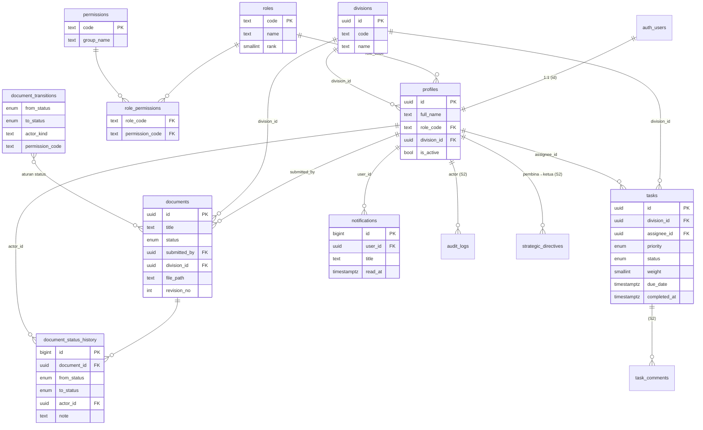

# ERD CENTRA

Status: ✅ = sudah dimigrasi di Sprint 1 · 🕓 = direncanakan Sprint 2.

## Kebijakan RLS ringkas
| Tabel | SELECT | Tulis |
|---|---|---|
| roles, permissions, role_permissions | pengguna aktif | `roles:manage_permissions` (hanya role_permissions) |
| divisions | pengguna aktif | `divisions:manage` |
| profiles | diri sendiri / pengguna aktif | `users:manage_roles` |
| tasks | `tasks:read_all` / `read_division` + divisi sama / `read_own` + assignee | Sprint 2 |
| documents | pengaju · `read_all` · `read_division` + divisi sama | INSERT `documents:create`; status hanya via RPC |
| document_status_history | mengikuti visibilitas dokumen | hanya trigger/RPC |
| notifications | pemilik | pemilik (read_at) |
| storage `documents` | pengaju atau dokumen yang terlihat | `documents:create` ke folder `{uid}/…` |
