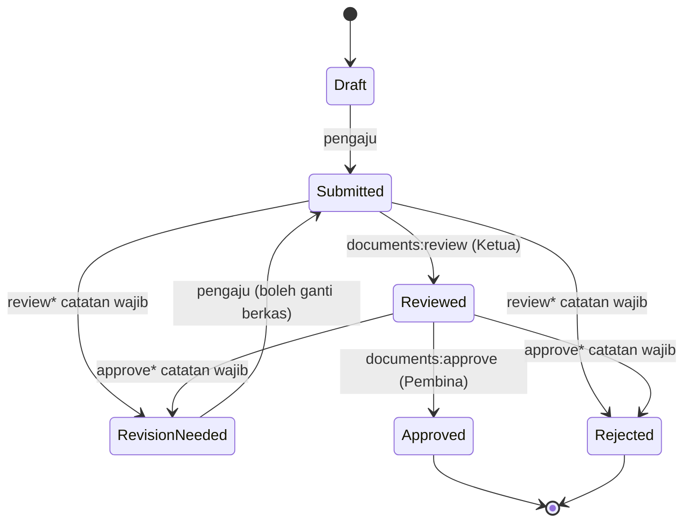

# State Machine Persuratan (US-05)

Sumber kebenaran: tabel `document_transitions` + RPC `transition_document`.

Aturan: pengaju tidak boleh mereviu/menyetujui suratnya sendiri; catatan wajib untuk revisi & penolakan;
setiap transisi mencatat aktor, waktu, catatan di `document_status_history` dan membuat notifikasi
(Submitted → pereviu; Reviewed → pembina + pengaju; hasil akhir → pengaju). Status tidak dapat diubah dengan UPDATE langsung.
